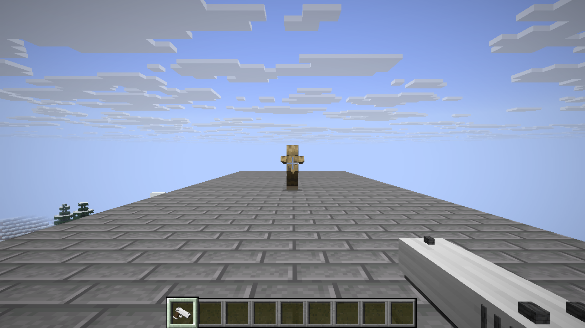
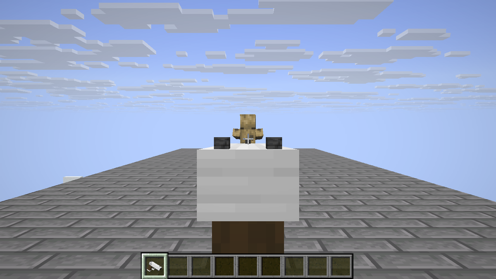
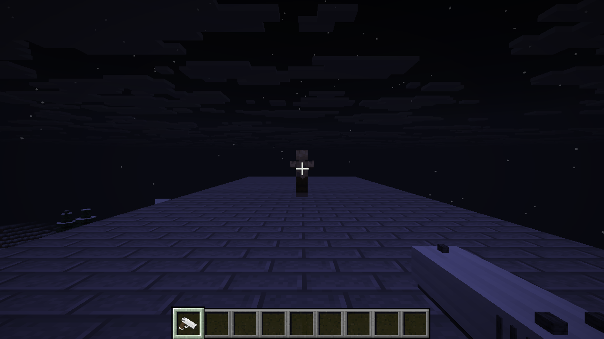
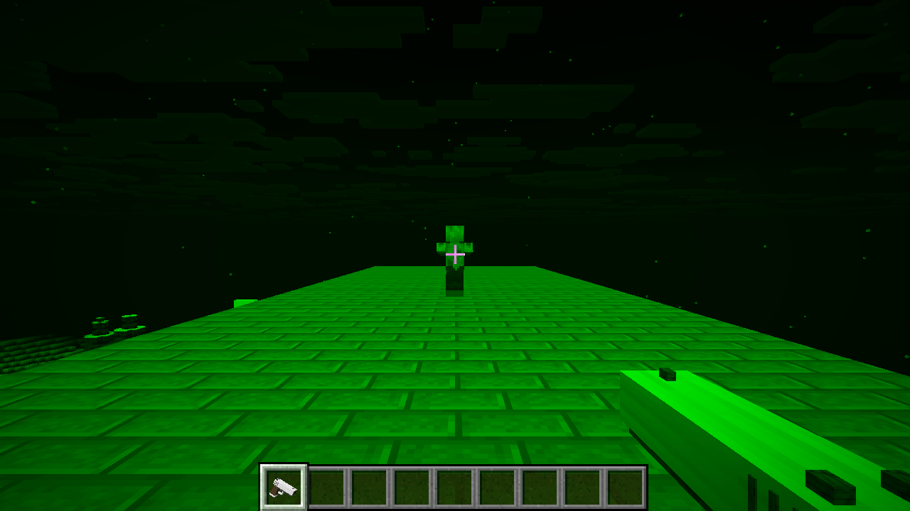
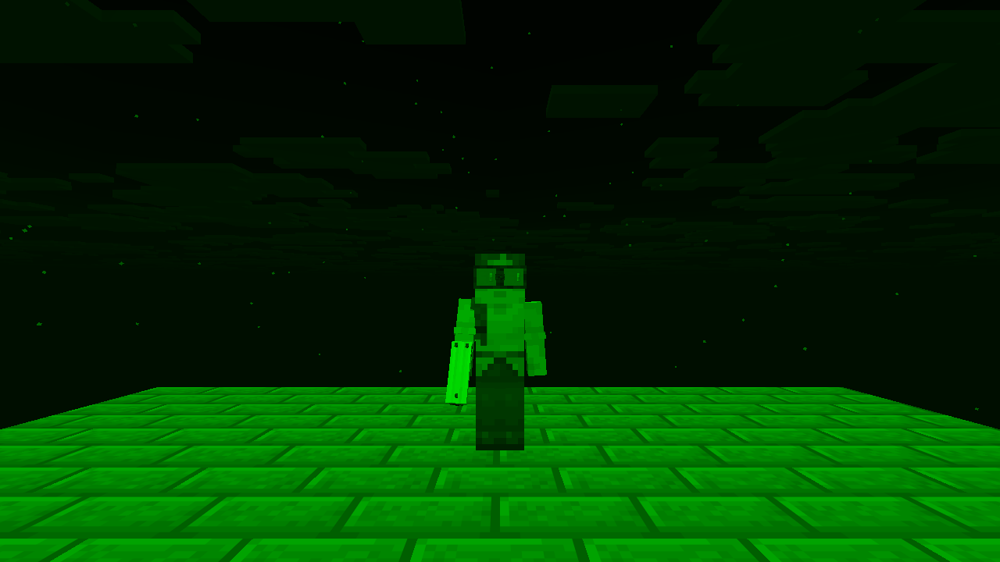

# Nightvision FPS

A single-player Minecraft Java mod with a semi-automatic pistol and wearable green night-vision goggles.

**Alpha 0.1.0-alpha.3.** Requires Minecraft Java **26.3**, Fabric Loader **0.20.1 or newer**, Fabric API **0.166.0+26.3**, and Java **25 or newer**.

Download the mod from [Releases](https://github.com/khanmahijyoti/nightvision-fps/releases). Report bugs through [Issues](https://github.com/khanmahijyoti/nightvision-fps/issues).



## Install

1. Install [Fabric Loader](https://fabricmc.net/use/installer/) for Minecraft **26.3**.
2. Download [Fabric API](https://modrinth.com/mod/fabric-api) **0.166.0+26.3** and `nightvision-fps-0.1.0-alpha.3.jar` from this repository's Releases page.
3. Put both JARs in your launcher's Minecraft `mods` folder. Keep one Nightvision FPS version installed at a time.
4. Launch your Fabric profile and open a single-player world. A pistol and a pair of goggles arrive automatically when inventory space is available.

The optional ZIP contains the same mod JAR, instructions, license, changelog, and screenshots. Extract it, then put the mod JAR in `mods`. Minecraft, Fabric Loader, and Fabric API are separate downloads.

## Pistol

Equip the **Iron Pistol** in your main hand. **Left-click** fires one shot per press. **Hold right-click** to aim with centered sights and a narrower first-person view. You can shoot while aiming. Release right-click to lower the pistol.

Each shot deals **8 base damage**, has a **64-block range**, and uses a **0.5-second cooldown**. This alpha has unlimited ammunition. Shots strike the nearest living target along the crosshair and stop at solid collision surfaces. Armor and projectile protection apply. Firing includes camera recoil, a muzzle flash, a brief tracer, impact particles, and a vanilla sound report.



## Night-vision goggles

Hold the **Night-Vision Goggles** and right-click to equip them, or move them into your inventory's **helmet slot**. Wearing them brightens dark surroundings and renders the scene in **green monochrome**. They work while aiming and shooting.

To remove them, open your inventory and move the goggles from the helmet slot into an empty inventory slot. Normal colors and lighting return. Existing potion effects remain intact. The goggles occupy the helmet slot and provide no armor points.







## Controls and equipment

| Control | Action |
| --- | --- |
| Left-click with pistol | Fire one shot |
| Hold right-click with pistol | Aim |
| Right-click while holding goggles | Equip goggles |
| Inventory helmet slot | Equip or remove goggles |
| F5 | Cycle Minecraft's camera views |

Minecraft's remapped Attack and Use bindings are respected. Aiming slows movement and prevents sprinting. Pistol firing works in first and third person; aiming zoom applies in first person.

New and existing single-player worlds receive one pistol and one pair of goggles per player. Death respawns replace missing equipment. Keep Inventory retains existing items, including their custom names. A full inventory keeps delivery pending until a slot is available. Dropping a claimed item during ordinary play does not immediately grant a replacement.

Both items are available in **Creative > Combat** and Creative search. With cheats enabled, use:

```text
/give @s iron_sidearm:iron_pistol
/give @s iron_sidearm:night_vision_goggles
```

## Compatibility

Nightvision FPS is a standalone mod. Ashen Arena can be installed alongside it, and the two were tested together. Single-player is the supported environment for this alpha. Multiplayer, LAN, dedicated servers, shader packs, and other mod combinations have not been validated.

When reporting bugs, include Minecraft and Fabric versions, reproduction steps, other installed mods, and relevant log excerpts with personal details removed.

## Build from source

Use Windows PowerShell with Minecraft Java **26.3** installed in the default Minecraft directory. The build uses the installation's **Java 25** runtime and client libraries.

1. Download the files listed in [deps/README.md](deps/README.md) into `deps`.
2. Run `powershell -ExecutionPolicy Bypass -File .\build.ps1`.
3. The compiled mod is written to `dist/nightvision-fps-0.1.0-alpha.3.jar`.

The generated item models are included in `resources`. Python 3 is needed when editing and rerunning `build_pistol_model.py`.

The integration-test harness in `test.ps1` and `test/sidearm` uses the original development paths under `E:/MinecraftPistol`, a disposable copy of the local `New World` save, and an optional Ashen Arena build under `E:/MinecraftArena`. Adapt these paths to run the harness on another machine.

## Rights

All rights reserved under [LICENSE](LICENSE). This branch contains the Java source, native resources, model generator, build script, and integration-test harness for 0.1.0-alpha.3.

The mod references textures, sounds, and shaders supplied by the player's Minecraft installation. Its release contains original code, model definitions, language strings, and data files. All gallery images are gameplay captures.

NOT AN OFFICIAL MINECRAFT PRODUCT. NOT APPROVED BY OR ASSOCIATED WITH MOJANG OR MICROSOFT. Minecraft belongs to its respective owners.
